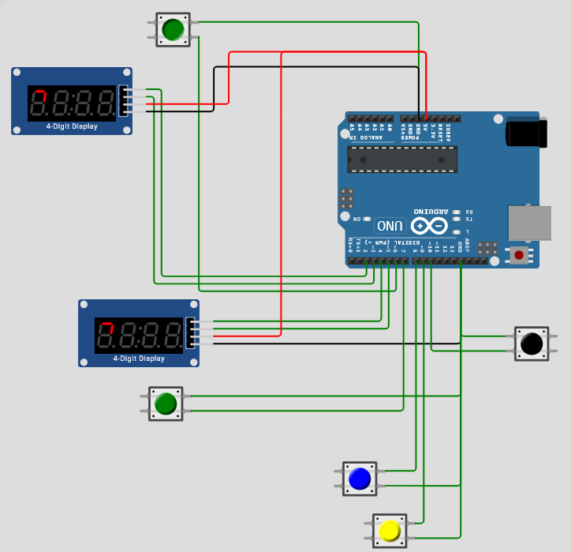

# ♟️ Pendule d'échecs Arduino

Pendule d'échecs réalisée pour le club d'échecs de l'école, dans le cadre de mon projet ingénieur citoyen.
Elle permet de chronométrer des parties entre deux joueurs, notamment lors des tournois du club.

## Fonctionnement

1. **Réglage** : les boutons **+** et **−** ajustent le temps de chaque joueur par pas de 5 secondes (de 0:05 à 99:55, 5:00 par défaut).
2. **Démarrage** : le joueur qui a les noirs appuie sur son bouton, ce qui valide le temps et lance le temps des blancs.
3. **Partie** : après avoir joué, chaque joueur appuie sur son bouton pour lancer le temps de l'adversaire.
4. **Fin** : quand le temps d'un joueur arrive à 00:00, son afficheur clignote.
5. **Reset** : revient au temps réglé à tout moment.

## Composants

| Composant | Quantité |
|---|---|
| Arduino Uno | 1 |
| Afficheur 7 segments TM1637 (4 chiffres) | 2 |
| Bouton poussoir | 5 (2 joueurs, +, −, reset) |
| Interrupteur à bascule (marche/arrêt) | 1 |

bouton bleu : +
bouton jaune : -

🔗 **Simulation en ligne :** [Ouvrir le projet sur Wokwi](https://wokwi.com/projects/477948250821662721)
